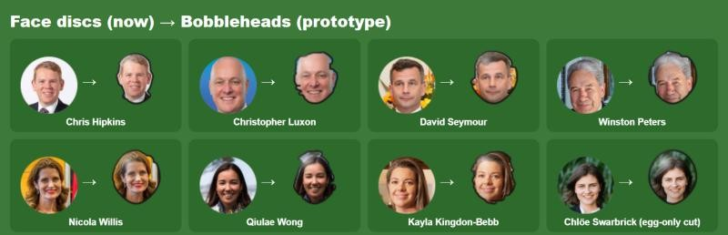
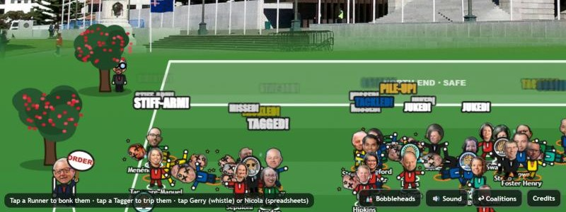
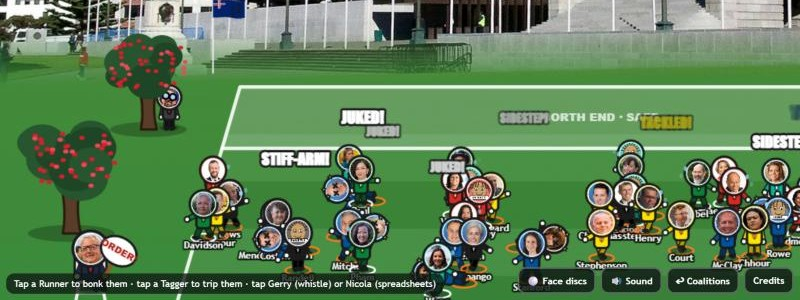
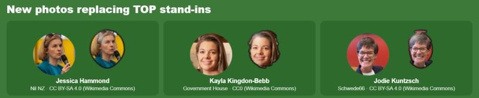

# Suggestion: bobblehead MPs and better photos

**Suggested by:** Sarah · **Date:** 13 November 2026 · **Status:** working prototype (code changes not yet committed)

The players have their faces in a circle on a cartoon body. This prototype makes them look like traditional bobbleheads instead: each head is cut out of its photo, outlined and glossed like painted resin, made bigger, and set on a coil spring. It also adds freely licensed photos for three Opportunity (TOP) MPs who were drawn stand-ins.

A **🎎 Bobbleheads / ⚪ Face discs** button in the bottom toolbar switches between the two looks, and the game remembers the choice.

## What it looks like

### Face discs (now) next to bobbleheads (prototype)

### In a match

Bobbleheads, about two seconds after kick-off:

The same moment with face discs:

### New photos for TOP

| MP | Photo | Licence | Why we're confident it's them |
|---|---|---|---|
| Jessica Hammond | [Jessica Hammond 2026.jpg](https://commons.wikimedia.org/wiki/File:Jessica_Hammond_2026.jpg), by Nil NZ | CC BY-SA 4.0 | Wearing an Opportunity-branded T-shirt. Replaces the old protest photo, which the repo had flagged as possibly the wrong person. |
| Kayla Kingdon-Bebb | [Kayla Kingdon-Bebb 2026 (further crop).jpg](https://commons.wikimedia.org/wiki/File:Kayla_Kingdon-Bebb_2026_(further_crop).jpg), by Government House | CC0 | Named in the Commons caption (WWF-NZ dinner, Government House Auckland, 7 May 2026). |
| Jodie Kuntzsch | [Jodie Kuntzsch 06 (cropped).jpg](https://commons.wikimedia.org/wiki/File:Jodie_Kuntzsch_06_(cropped).jpg), by Schwede66 | CC BY-SA 4.0 | Commons caption "Jodie Kuntzsch in 2026", wearing an Opportunity T-shirt. |

## How it works

- **Cutting out the head.** The game takes the existing square crop of each photo, masks it to an egg shape (wide crown, narrower jaw), then removes background that matches the colour at the photo's edges. A protected oval in the middle stops it eating into faces. Each row is filled solidly from edge to edge, so bald heads and sky-blue shirts don't end up with holes, and the outline is smoothed.
- **Fallback.** If removing the background would take away too much of the head, because the skin or hair is close to the backdrop colour, it uses the egg shape alone. That happens for 7 of the 60 photos, including Swarbrick, Shane Jones and Waititi.
- **The look.** The cut-out gets a dark outline, a glossy highlight and a little shading under the chin. It's drawn 32% larger than the old disc, on a stack of spring coils. The existing wobble and squash, knocked-out eyes, binoculars and sunglasses all still work.
- **Reading photo pixels.** Browsers only allow pixel access when the image server sends CORS headers. Wikimedia's `Special:FilePath` links redirect without them, so the build now also writes a direct `upload.wikimedia.org` thumbnail URL (`cors` in `data.js`). If that fails, the game loads the old URL and shows the face disc.
- **Stand-ins.** MPs without a photo keep their drawn cardboard-mask disc.

### Files changed

| File | Change |
|---|---|
| `game.js` | Cut-out heads (`cutHead`), bobblehead drawing in `person()`, image loading with a fallback, the toolbar toggle, and `bobbles` added to `window.__bullrush` for debugging |
| `index.html` | 🎎 Bobbleheads button |
| `tools/build-data.js` | Writes the `cors` thumbnail URL. Removes Jessica Hammond from `NO_PHOTO` |
| `manifest/top.json` | Photo, licence and attribution for Hammond, Kingdon-Bebb and Kuntzsch |
| `data.js` | Rebuilt |

You can turn it on or off from the address bar with `?bobble=1` or `?bobble=0`.

## Known rough edges

- Busy backgrounds can leave a sliver of colour around the hair: red behind Kuntzsch, yellow around Hammond.
- Photos cut with the egg fallback have a smooth oval outline rather than following the hair.
- Seven MPs still have no free photo, so they show as drawn discs among the bobbleheads: Craig Renney (Labour), Jessica Rowe (National), Taine Randell and Craig Stobo (NZ First), and Daniel Eb, Eden Skipper and Sarah Lucas (TOP). The Commons photos called "Jessica Rowe" are of the Australian TV presenter, not the National MP.
- `tools/build-data.js` was edited but not run, because Node wasn't installed on the machine. `data.js` was rebuilt with a Python copy of the script, which reproduced the existing `data.js` byte for byte before the changes. Running `node tools/build-data.js` should give the same output.

## Recommended next steps

1. **Play it and decide on the default.** The prototype starts in bobblehead mode. If it's a keeper, keep the toggle and leave bobbleheads on by default.
2. **Run the real build.** Run `node tools/build-data.js` and check `data.js` comes out unchanged. This confirms the Node script matches the Python copy used here.
3. **Pre-cut the heads (best quality).** Instead of cutting heads out in the browser, cut each head once with a proper background-removal tool, check it by eye, and commit the transparent PNGs, for example under `heads/`. This fixes the slivers and the egg-only outlines, and the game no longer needs pixel access.
   - **Licensing:** the cut-outs are derivatives. CC BY-SA photos must stay CC BY-SA and keep their attribution, which the credits screen already shows.
4. **Find the last seven photos.** Check Wikimedia Commons again after the official results on 27 November; new MPs' photos often appear after the swearing-in. Parliament's official portraits are another source once published, but check their licence first. Until then, the stand-in art could be restyled to look like a bobblehead.
5. **Small polish ideas.** Show the winning team's heads on bobblehead plinths on the results screen, and give the heads a bigger nod when they're tackled.

---

*Screenshots contain photos from Wikimedia Commons; credits are in the game's Credits panel and in `manifest/*.json`. The three photos above are credited in the table.*
