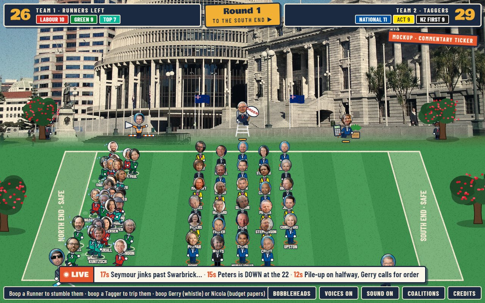
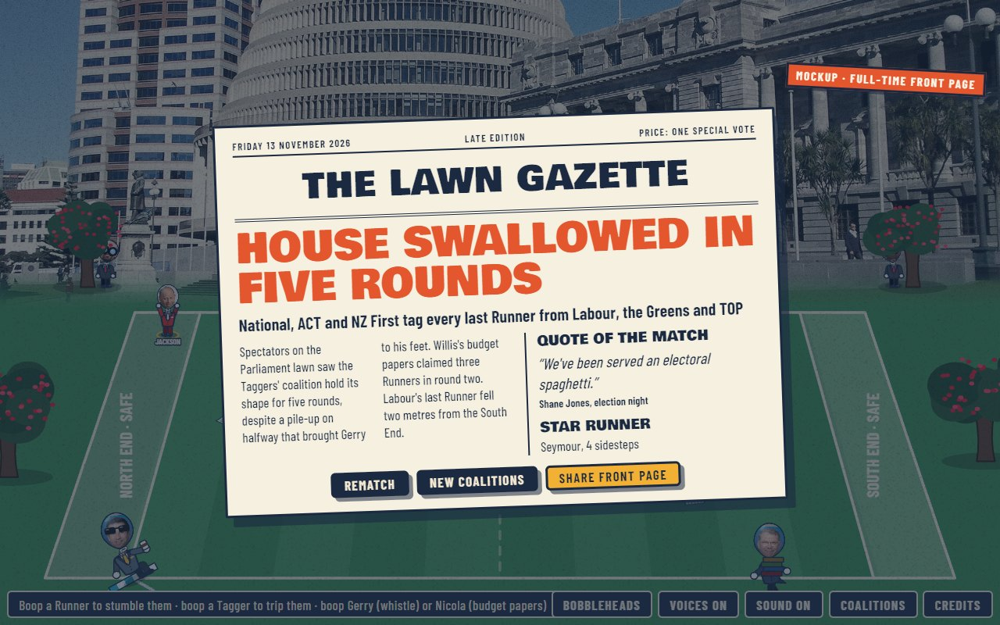
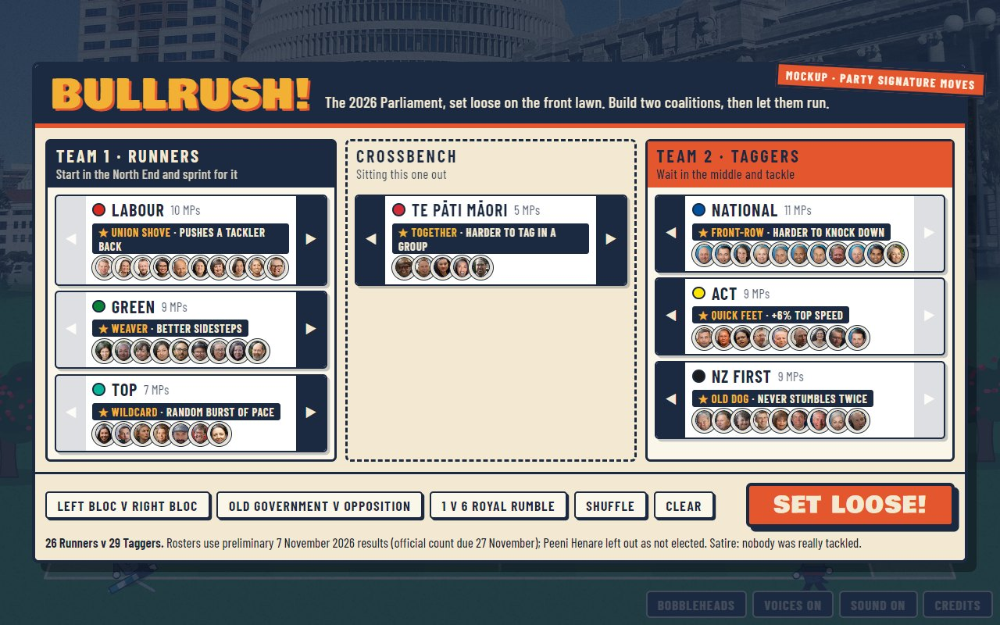
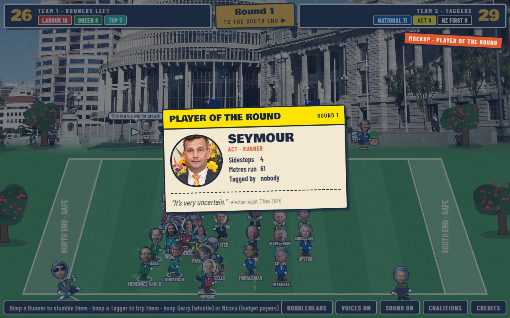
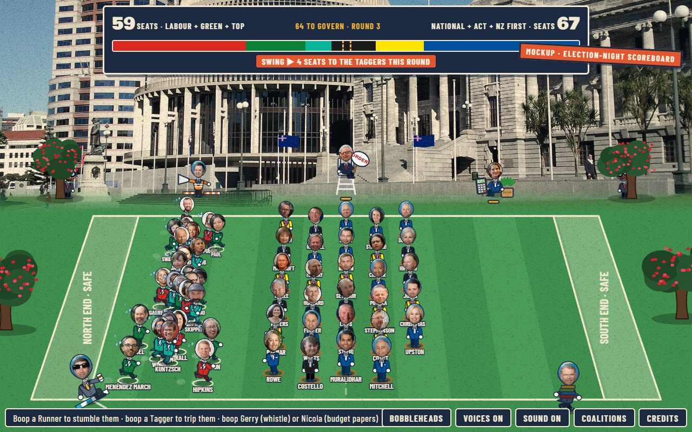
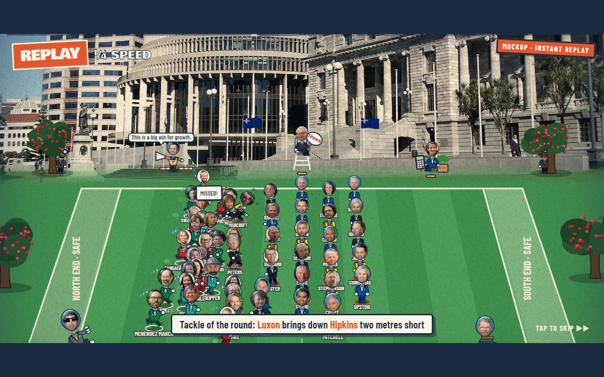
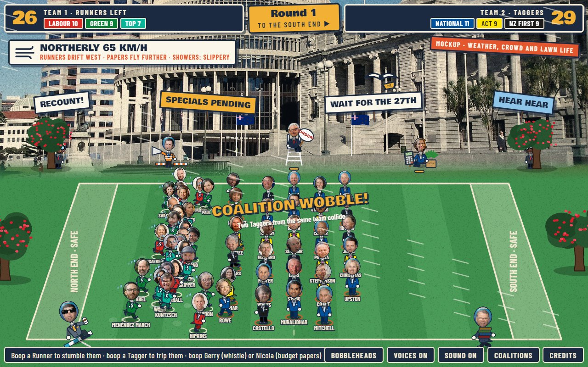

# Suggestion: polish and colour for match day

**Suggested by:** Sarah · **Date:** 13 November 2026 · **Status:** mockups only, no game code changed

These seven ideas would make each match feel more like a broadcast and give the coalitions more personality. Each one is shown below as a mockup over a real screenshot of the current game. An orange **Mockup** stamp marks each image.

The mockups follow the house rules in `CLAUDE.md`: the match-day programme style (six inks, Bowlby One and Barlow Condensed), and real people only say real, sourced lines. Everything else on screen, such as commentary, headlines and crowd signs, is written *about* the match, not put in anyone's mouth.

| # | Idea | Effort | Colour it adds |
|---|---|---|---|
| 1 | Commentary ticker | Small | High |
| 2 | Full-time front page | Small | High |
| 3 | Party signature moves | Medium | High: makes the coalition choice matter |
| 4 | Player of the round | Small | Medium |
| 5 | Election-night seat scoreboard | Medium | Medium |
| 6 | Instant replay | Large | Medium |
| 7 | Weather, crowd signs and lawn life | Medium | Medium |

## 1. Commentary ticker

- A broadcast-style strip above the toolbar, with the newest event first: sidesteps, tackles, pile-ups, Gerry calling for order, Willis's papers.
- It's built from events the game already tracks (`fx()` calls for JUKED, TAGGED, PILE-UP and so on), so it's mostly text templates such as "{runner} jinks past {tagger}".
- Keep the lines descriptive ("Peters is down at the 22"), never invented speech.

## 2. Full-time front page

- Replaces the full-time panel with a front page from a made-up paper, *The Lawn Gazette*, dated on the day.
- The headline is generated from the result, e.g. "HOUSE SWALLOWED IN FIVE ROUNDS" for a total conversion, or "LAST GREEN STANDING" when one runner survives.
- **Quote of the match:** one sourced line from someone who played, taken from `QUOTES`.
- **Share front page:** saves it as an image, which is good for spreading the game around.

## 3. Party signature moves

- One small trait per party, shown on its team-builder card, so picking coalitions becomes a real choice:

| Party | Move | Effect |
|---|---|---|
| Labour | Union shove | Pushes a tackler back |
| National | Front-row | Harder to knock down |
| Green | Weaver | Better sidesteps |
| ACT | Quick feet | +6% top speed |
| NZ First | Old dog | Never stumbles twice |
| TOP | Wildcard | Random bursts of pace |
| Te Pāti Māori | Together | Harder to tag in a group |

- Keep the effects small, so balance stays within the 5 to 8 rounds the game aims for. Re-run the simulated matches after each change (`update(1/60)` in a loop).
- These are placeholders. Each party's trait should be checked so it isn't mean-spirited or culturally loaded.

## 4. Player of the round

- Between rounds, a programme-style card shows the best runner or tagger: their photo, simple stats, and one of their sourced quotes.
- The stats (sidesteps, metres run, tags made) need small counters on each MP.

## 5. Election-night seat scoreboard

- Show the score as **seats** instead of runners: each MP is worth their party's share of its seats.
- A bar in party colours shows each side's seats, with the majority line marked and a "swing" banner after each round.
- It ties the game back to the real election (the official count is on 27 November).

## 6. Instant replay

- Slow-motion replay of the tackle of the round, letterboxed, with a REPLAY stamp and a one-line caption.
- **Effort:** this is the biggest job. The game would need to record recent positions (a short ring buffer of `G.mps` states) and play them back.
- Tap to skip, and never on by default for the first round.

## 7. Weather, crowd signs and lawn life

- **Wellington weather:** a northerly that pushes runners sideways and blows Willis's papers further, or showers that make the lawn slippery. It's random each match and announced in a banner.
- **Crowd placards** behind the lawn, with election-week slogans that match the crowd shouts: RECOUNT!, SPECIALS PENDING, WAIT FOR THE 27TH.
- **Lawn life:** a seagull stealing a pie, or a school tour crossing the lawn. Nobody real.
- **Coalition wobble:** sometimes two taggers from the same team collide, with a pop-up. It's a cheap joke that also adds some chaos.
- Keep the sound soft. The weather should use the existing plucks and pops; no whooshes.

## Recommended order

1. **Commentary ticker** and **full-time front page**: small jobs that add the most colour.
2. **Party signature moves**: the biggest gameplay gain. Agree the traits first, then tune balance.
3. **Player of the round** and the **seat scoreboard**, which share the same stat counters.
4. **Weather and lawn life**, then **instant replay** last.

## Also worth a look

- **Phone haptics:** a short vibration on big tackles (`navigator.vibrate`). It's cheap and feels good.
- **Season mode:** best of five matches with a simple results table.
- **Sharing:** a public play link. GitHub Pages isn't enabled yet, per `CLAUDE.md`.

---

*The mockups were made by putting temporary HTML over the running game in a headless browser; no game code was changed. Photos are hot-linked from Wikimedia Commons as in the game, and quotes come from the game's sourced `QUOTES`.*
